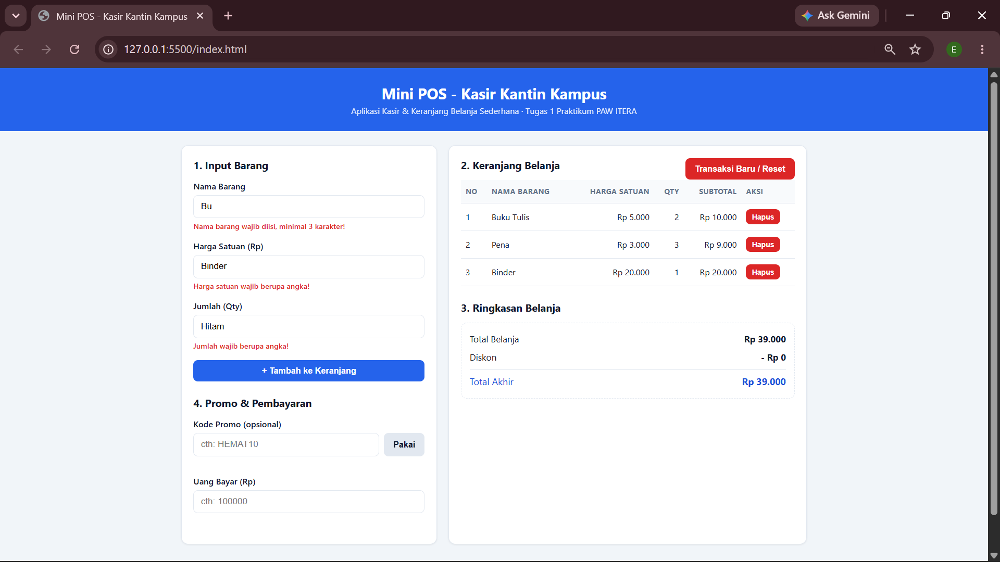
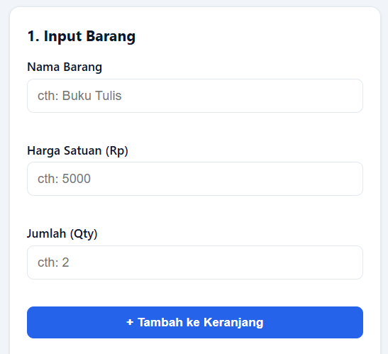
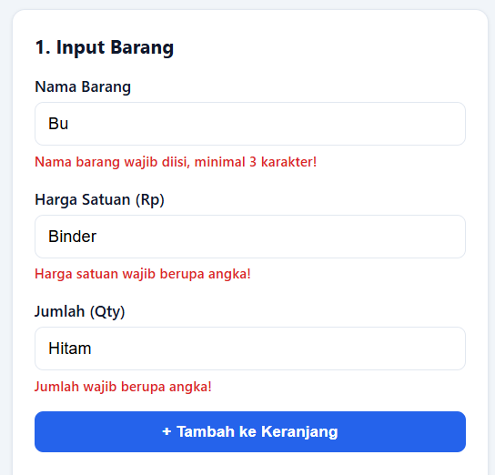
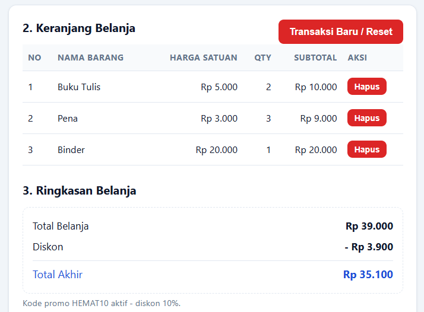

# Praktikum PAW Pertemuan 1 - HTML, CSS dan JavaScript Dasar (Mini POS)

**Program Studi Teknik Informatika - Institut Teknologi Sumatera**
**T.A. 2026/2027 Gasal**

## Identitas

- **Nama Lengkap:** Erhan Kurniawan
- **NIM:** 124140217
- **Kelas Praktikum:** RA
- **Pertemuan:** 01 - HTML, CSS dan JavaScript Dasar

Repository ini berisi pengerjaan Tugas **Mini POS (Aplikasi Kasir & Keranjang Belanja Sederhana)** dan latihan modul 1-4 untuk Pertemuan 1.

---

## Struktur Folder

```text
ErhanKurniawan_124140217_pertemuan1/
├── README.md
├── index.html                         # halaman utama Mini POS
├── style.css                          # styling & tampilan responsif
├── script.js                          # logika validasi, kalkulator, keranjang, localStorage
└── modul/                             # latihan modul 1-4
    ├── latihan1/
    │   ├── index.html
    │   └── script.js
    ├── latihan2/
    │   ├── index.html
    │   └── script.js
    ├── latihan3/
    │   ├── index.html
    │   └── script.js
    └── latihan4/
        ├── index.html
        └── script.js
```

---

## Tugas - Mini POS (Aplikasi Kasir & Keranjang Belanja)

Lokasi: root folder ini (terpisah dari latihan di folder `modul/`).

### 1. Penjelasan Singkat Fungsi Aplikasi & Fitur-Fiturnya

Mini POS adalah aplikasi web kasir dan keranjang belanja sederhana untuk kantin/toko kampus. Aplikasi ini menyatukan tiga kompetensi dasar praktikum: validasi input form, perhitungan kalkulator otomatis (subtotal, total, diskon, kembalian), dan manajemen keranjang belanja berbasis `localStorage` sehingga data tidak hilang saat halaman di-refresh.

**Daftar Fitur:**

| Fitur                          | Keterangan                                                                      |
| ------------------------------ | ------------------------------------------------------------------------------- |
| Validasi Form                  | Nama barang minimal 3 karakter, harga minimal Rp 500, qty bilangan bulat minimal 1 |
| Pesan Error Visual             | Pesan error merah di bawah input yang salah; barang tidak masuk keranjang       |
| Reset Form Otomatis            | Form dikosongkan setelah barang berhasil ditambahkan                            |
| Subtotal Otomatis              | Subtotal per baris (harga × qty)                                                |
| Total Belanja Otomatis         | Dijumlahkan dari seluruh subtotal                                               |
| Diskon Otomatis                | Diskon 10% jika total ≥ Rp 50.000 atau memakai kode promo `HEMAT10`             |
| Kalkulator Uang Bayar          | Menghitung kembalian, termasuk pesan jika uang kurang                           |
| Tabel Keranjang                | Kolom No, Nama Barang, Harga Satuan, Qty, Subtotal, Aksi                        |
| Hapus Barang                   | Tombol Hapus per baris dengan perhitungan ulang otomatis                        |
| Persistensi `localStorage`     | Keranjang disimpan dengan `JSON.stringify` / `JSON.parse`                       |
| Transaksi Baru / Reset         | Mengosongkan keranjang dan membersihkan `localStorage`                          |
| Format Rupiah & Responsif      | `Intl.NumberFormat` dan layout menyesuaikan ukuran layar                        |

---

### 2. Screenshot Antarmuka Aplikasi

> Catatan: File screenshot diletakkan di folder `docs/screenshots/pertemuan1/` (root repository).

| No  | Nama File            | Keterangan                                                            |
| --- | -------------------- | --------------------------------------------------------------------- |
| 1   | `Full_Screen.png`    | Tampilan penuh aplikasi Mini POS                                      |
| 2   | `Form_Input.png`     | Form input barang dengan placeholder panduan pengguna                 |
| 3   | `Validasi_Error.png` | Validasi form: pesan error merah muncul saat input tidak sesuai syarat |
| 4   | `Keranjang.png`      | Tabel keranjang, subtotal otomatis, dan ringkasan total + diskon      |

**Gambar 1 - Tampilan Penuh Mini POS**



**Gambar 2 - Form Input Barang**



**Gambar 3 - Validasi Form (Pesan Error)**



**Gambar 4 - Tabel Keranjang, Total & Diskon**



---

### 3. Penjelasan Teknis Singkat

#### Penanganan Validasi Input

Fungsi `validasiForm()` memeriksa ketiga input satu per satu. Setiap kegagalan menulis pesan ke elemen `<small class="error-message">` di bawah input terkait dan mengembalikan `null`, sehingga `tambahBarang()` berhenti sebelum barang masuk keranjang.

#### Algoritma Kalkulator Keuangan

`hitungTotalBelanja()` mengakumulasi subtotal (`harga × qty`) dengan `reduce()`, lalu menentukan diskon: 10% diberikan jika kode promo `HEMAT10` valid dimasukkan, atau secara otomatis jika total belanja mencapai minimal Rp 50.000 tanpa kode promo. `hitungKembalian()` menghitung `uangBayar − totalAkhir`; jika negatif, ditampilkan pesan "uang belum mencukupi" beserta nominal kekurangannya.

#### Mekanisme Serialisasi `localStorage`

Array objek keranjang disimpan dengan `localStorage.setItem(KEY, JSON.stringify(keranjang))` setiap ada perubahan (tambah/hapus/reset), dan dimuat ulang saat halaman dibuka dengan `JSON.parse(localStorage.getItem(KEY))`, sehingga isi keranjang bertahan setelah refresh.

---

## Cara Menjalankan Aplikasi

### Prasyarat

- Browser modern (Chrome, Edge, Firefox)
- (Opsional) VS Code dengan extension Live Server

### Langkah

1. Clone repository: `git clone https://github.com/hanxx166/pemrograman_web_itera_124140217.git`
2. Buka folder `ErhanKurniawan_124140217_pertemuan1` di VS Code.
3. Klik kanan `index.html` lalu pilih **Open with Live Server**, atau buka langsung di browser. Server tidak wajib karena aplikasi tidak memakai Fetch API.
4. Latihan modul 1-4 dapat dibuka dari `modul/latihan1` sampai `modul/latihan4` (masing-masing `index.html`).

### Alur Pengujian Fitur

1. **Validasi:** kosongkan nama atau isi harga di bawah Rp 500; pesan error merah muncul dan barang tidak masuk keranjang.
2. **Tambah barang:** isi form dengan benar; barang muncul di tabel dan form ter-reset.
3. **Diskon:** buat total ≥ Rp 50.000 atau masukkan kode `HEMAT10`; diskon 10% diterapkan.
4. **Kembalian:** isi uang bayar; kembalian atau pesan uang kurang tampil.
5. **Hapus:** klik tombol Hapus; total dihitung ulang.
6. **Persistensi:** refresh halaman (`F5`); isi keranjang tetap ada.
7. **Reset:** klik Transaksi Baru; keranjang dan `localStorage` dikosongkan.

---

## Teknologi

- HTML5 & CSS3 (layout responsif)
- Vanilla JavaScript (DOM, `reduce()`, `Intl.NumberFormat`)
- Web Storage API (`localStorage`) - persistensi data

---

<div align="center">

**© 2026 · Tugas 1 Praktikum Pengembangan Aplikasi Web · Teknik Informatika ITERA**

</div>
