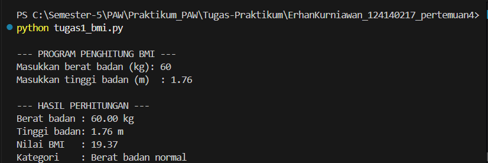
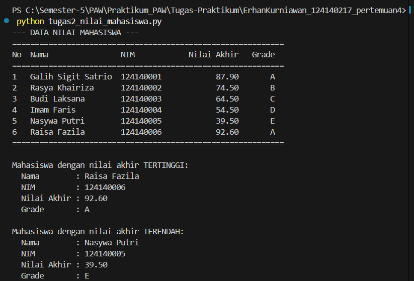
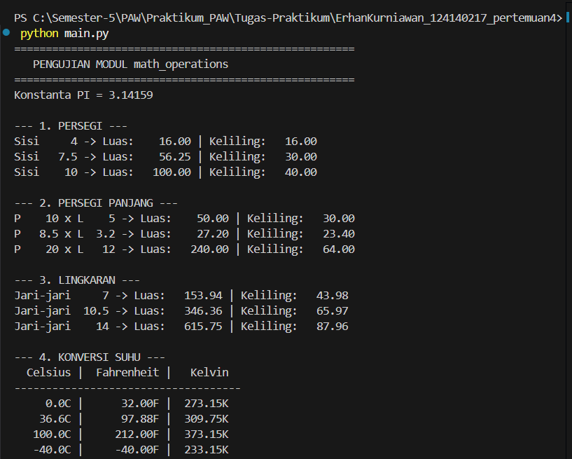

# Praktikum PAW Pertemuan 4 - Python Dasar (BMI, Nilai Mahasiswa, Modul Matematika)

**Program Studi Teknik Informatika - Institut Teknologi Sumatera**
**T.A. 2026/2027 Gasal**

## Identitas

- **Nama Lengkap:** Erhan Kurniawan
- **NIM:** 124140217
- **Kelas Praktikum:** RA
- **Pertemuan:** 04 - Python Dasar

Repository ini berisi pengerjaan 3 soal tugas dan latihan mandiri Modul 1-6 untuk Pertemuan 4.

---

## Struktur Folder

```text
ErhanKurniawan_124140217_pertemuan4/
├── README.md
├── .gitignore                         # mengecualikan venv/ dan __pycache__/
├── tugas1_bmi.py                      # Soal 1: penghitung BMI
├── tugas2_nilai_mahasiswa.py          # Soal 2: pengelolaan data nilai mahasiswa
├── math_operations.py                 # Soal 3: modul geometri & konversi suhu
├── main.py                            # Soal 3: program utama pemakai modul
└── latihan/
    ├── latihan1.py                    # kartu identitas berbingkai
    ├── latihan2_suhu.py               # konversi Celsius ke Fahrenheit & Kelvin
    ├── latihan3_tebak.py              # game tebak angka
    ├── latihan4_validasi.py           # validator password
    ├── latihan5_kontak.py             # katalog kontak (dictionary)
    ├── password_gen.py                # modul generator password (latihan 6)
    └── main.py                        # pengujian modul password_gen
```

> Catatan: `main.py` di folder `latihan/` adalah pengujian modul `password_gen.py` (latihan 6)
> dan **berbeda** dengan `main.py` di folder utama yang menjadi bagian Soal 3.

---

## Tugas - Python Dasar

Lokasi: root folder ini.

### 1. Penjelasan Singkat Program

| No  | Soal                        | Berkas                                        | Keterangan                                                                                       |
| --- | --------------------------- | --------------------------------------------- | ------------------------------------------------------------------------------------------------ |
| 1   | Penghitung BMI              | `tugas1_bmi.py`                               | Menghitung BMI dari berat & tinggi badan, lalu menentukan kategori dengan `if-elif-else`         |
| 2   | Pengelolaan Nilai Mahasiswa | `tugas2_nilai_mahasiswa.py`                   | Mengolah data 6 mahasiswa (list & dictionary), menghitung nilai akhir & grade, mencari max/min   |
| 3   | Modul Matematika            | `math_operations.py`, `main.py`               | Modul fungsi geometri & konversi suhu beserta program utama yang mengimpornya dengan dua cara     |

#### Soal 1 - Program Penghitung BMI

**Alur kerja:**

1. Program meminta input berat badan (kg) dan tinggi badan (m) melalui `input()`.
2. Fungsi `hitung_bmi()` menghitung BMI dengan rumus `berat / (tinggi * tinggi)`.
3. Fungsi `tentukan_kategori()` menentukan kategori dengan `if-elif-else`:

   | Rentang BMI      | Kategori            |
   | ---------------- | ------------------- |
   | BMI < 18.5       | Berat badan kurang  |
   | 18.5 ≤ BMI < 25  | Berat badan normal  |
   | 25 ≤ BMI < 30    | Berat badan berlebih |
   | BMI ≥ 30         | Obesitas            |

4. Program mencetak berat, tinggi, nilai BMI (2 angka desimal), dan kategori. Jika berat atau tinggi ≤ 0, program menampilkan pesan error.

**Contoh keluaran (input berat 65 kg, tinggi 1.70 m):**

```text
--- HASIL PERHITUNGAN ---
Berat badan : 65.00 kg
Tinggi badan: 1.70 m
Nilai BMI   : 22.49
Kategori    : Berat badan normal
```

#### Soal 2 - Pengelolaan Data Nilai Mahasiswa

**Alur kerja:**

1. Data 6 mahasiswa disimpan dalam list berisi dictionary dengan kunci `nama`, `nim`, `nilai_uts`, `nilai_uas`, dan `nilai_tugas`.
2. `hitung_nilai_akhir()` menghitung nilai akhir: `30% × UTS + 40% × UAS + 30% × Tugas`.
3. `tentukan_grade()` menentukan grade: A (≥ 80), B (70-79), C (60-69), D (50-59), E (< 50).
4. `proses_data()` menambahkan `nilai_akhir` dan `grade` ke setiap dictionary.
5. `tampilkan_tabel()` mencetak Nama, NIM, Nilai Akhir, dan Grade dalam tabel rapi memakai perataan f-string.
6. `max()` dan `min()` dengan `lambda` mencari mahasiswa bernilai akhir tertinggi dan terendah, lalu `tampilkan_info()` mencetak datanya.

**Contoh keluaran:**

```text
==================================================================
No  Nama                NIM            Nilai Akhir   Grade
==================================================================
1   Andi Pratama        124140001            87.90       A
2   Budi Santoso        124140002            74.50       B
3   Citra Lestari       124140003            64.50       C
4   Dewi Anggraini      124140004            54.50       D
5   Eko Prasetyo        124140005            39.50       E
6   Fajar Ramadhan      124140006            92.60       A
==================================================================

Mahasiswa dengan nilai akhir TERTINGGI:
  Nama        : Fajar Ramadhan
  Nilai Akhir : 92.60
  Grade       : A

Mahasiswa dengan nilai akhir TERENDAH:
  Nama        : Eko Prasetyo
  Nilai Akhir : 39.50
  Grade       : E
```

#### Soal 3 - Modul Matematika

**`math_operations.py` (modul)** berisi:

- Konstanta `PI = 3.14159`
- Geometri: `luas_persegi()`, `keliling_persegi()`, `luas_persegi_panjang()`, `keliling_persegi_panjang()`, `luas_lingkaran()`, `keliling_lingkaran()`
- Konversi suhu: `celsius_ke_fahrenheit()` dan `celsius_ke_kelvin()`
- Blok `if __name__ == "__main__":` untuk pengujian mandiri modul

**`main.py` (program utama):**

1. Mengimpor modul dengan **dua cara berbeda**:
   - `import math_operations` (dipakai untuk persegi dan persegi panjang)
   - `from math_operations import ...` (dipakai untuk lingkaran dan konversi suhu)
2. Memanggil seluruh fungsi dengan beberapa nilai uji.
3. Menampilkan hasil dalam format rapi dan terstruktur.

**Contoh keluaran (sebagian):**

```text
--- 3. LINGKARAN ---
Jari-jari     7 -> Luas:   153.94 | Keliling:   43.98

--- 4. KONVERSI SUHU ---
  Celsius |  Fahrenheit |   Kelvin
     100.0C |      212.00F |  373.15K
```

---

### 2. Screenshot Hasil Eksekusi

> Catatan: File screenshot diletakkan di folder `docs/screenshots/pertemuan4/` (root repository).

| No  | Nama File                 | Keterangan                                   |
| --- | ------------------------- | -------------------------------------------- |
| 1   | `tugas1_bmi.png`          | Hasil eksekusi Soal 1 (penghitung BMI)       |
| 2   | `tugas2_nilai_mahasiswa.png` | Hasil eksekusi Soal 2 (tabel nilai & max/min) |
| 3   | `tugas3_main.png`         | Hasil eksekusi Soal 3 (modul matematika)     |

**Gambar 1 - Soal 1: Penghitung BMI**



**Gambar 2 - Soal 2: Pengelolaan Nilai Mahasiswa**



**Gambar 3 - Soal 3: Modul Matematika**



---

### 3. Pemenuhan Persyaratan

| No  | Persyaratan                                   | Implementasi                                                  |
| --- | --------------------------------------------- | ------------------------------------------------------------- |
| 1   | Input pengguna & percabangan `if-elif-else`   | `tugas1_bmi.py` (`input()`, `tentukan_kategori()`)            |
| 2   | List dan dictionary                           | `tugas2_nilai_mahasiswa.py` (list berisi dictionary mahasiswa) |
| 3   | Fungsi, `lambda`, `max()` / `min()`           | `tugas2_nilai_mahasiswa.py`                                   |
| 4   | Modul dan dua cara import                     | `math_operations.py` dan `main.py`                            |
| 5   | `if __name__ == "__main__":`                  | `math_operations.py`                                          |
| 6   | Docstring pada seluruh fungsi                 | Seluruh berkas `.py`                                          |

---

## Latihan Mandiri (folder `latihan/`)

| No  | Berkas                | Keterangan                                   |
| --- | --------------------- | -------------------------------------------- |
| 1   | `latihan1.py`         | Kartu identitas berbingkai `#`               |
| 2   | `latihan2_suhu.py`    | Konversi Celsius ke Fahrenheit & Kelvin      |
| 3   | `latihan3_tebak.py`   | Game tebak angka                             |
| 4   | `latihan4_validasi.py`| Validator password                           |
| 5   | `latihan5_kontak.py`  | Katalog kontak dengan dictionary             |
| 6   | `password_gen.py` + `main.py` | Modul generator password dan pengujiannya |

---

## Cara Menjalankan Program

### Prasyarat

- Python 3.8 atau lebih baru (`python --version`)
- Tidak ada library eksternal; seluruh program memakai fitur bawaan Python
- Pengguna macOS/Linux dapat mengganti `python` dengan `python3`

### Langkah (Tugas)

```bash
cd ErhanKurniawan_124140217_pertemuan4
python tugas1_bmi.py
python tugas2_nilai_mahasiswa.py
python main.py
```

### Langkah (Latihan Mandiri)

```bash
cd ErhanKurniawan_124140217_pertemuan4/latihan
python latihan1.py
python latihan2_suhu.py
python latihan3_tebak.py
python latihan4_validasi.py
python latihan5_kontak.py
python main.py          # menguji modul password_gen (latihan 6)
```

---

## Teknologi

- Python 3.8+ (pustaka standar)
- Konsep: input/output, percabangan, list & dictionary, fungsi, `lambda`, modul & import
- Kode mengikuti konvensi PEP 8 (indentasi 4 spasi, penamaan `snake_case`)

---

<div align="center">

**© 2026 · Tugas 4 Praktikum Pengembangan Aplikasi Web · Teknik Informatika ITERA**

</div>
