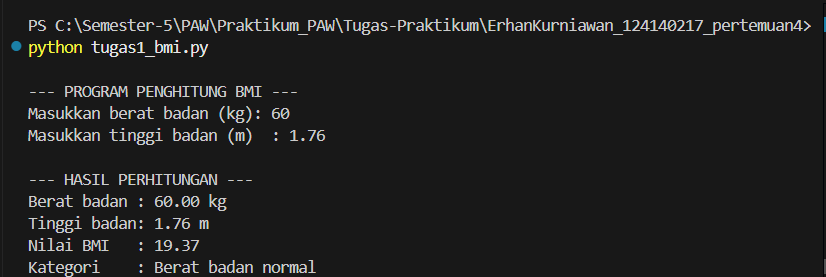
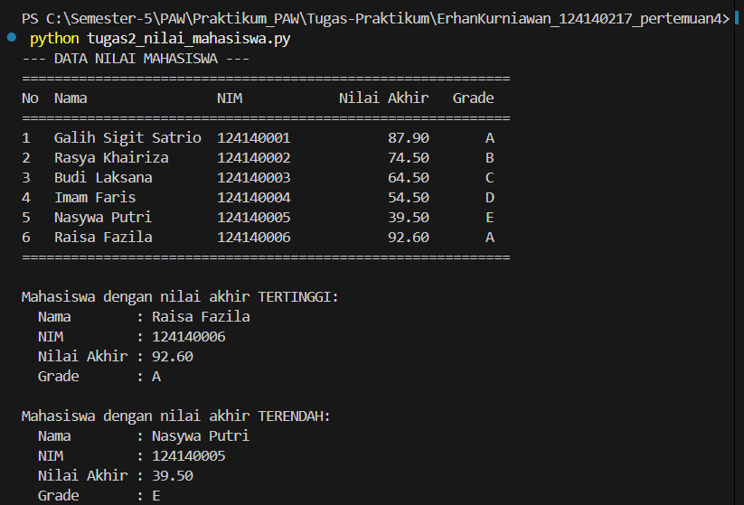
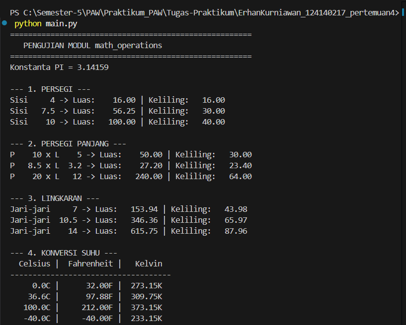

# Tugas Praktikum Pertemuan 4: Python Dasar

Praktikum Pengembangan Aplikasi Web, Teknik Informatika ITERA (T.A. 2026/2027 Gasal)

## Identitas Mahasiswa

| | |
|---|---|
| **Nama** | Erhan Kurniawan |
| **NIM** | 124140217 |

## Struktur Folder

```
ErhanKurniawan_124140217_pertemuan4/
├── .gitignore
├── README.md
├── tugas1_bmi.py
├── tugas2_nilai_mahasiswa.py
├── math_operations.py
├── main.py
└── latihan/
    ├── latihan1.py
    ├── latihan2_suhu.py
    ├── latihan3_tebak.py
    ├── latihan4_validasi.py
    ├── latihan5_kontak.py
    ├── password_gen.py
    └── main.py
```

> Folder `latihan/` berisi latihan mandiri Modul 1-6. File `main.py` di dalamnya
> adalah pengujian modul `password_gen.py` (latihan 6) dan **berbeda** dengan
> `main.py` di folder utama yang menjadi bagian Soal 3.

## Prasyarat

- Python 3.8 atau lebih baru (`python --version`)
- Tidak ada library eksternal. Semua program hanya memakai fitur bawaan Python.

## Deskripsi dan Cara Menjalankan

Buka terminal (misalnya terminal terintegrasi VS Code) di dalam folder
`ErhanKurniawan_124140217_pertemuan4`, lalu jalankan perintah pada setiap soal.
Untuk pengguna macOS/Linux, ganti `python` dengan `python3`.

### Soal 1: Program Penghitung BMI (`tugas1_bmi.py`)

**Alur kerja:**
1. Program meminta input berat badan (kg) dan tinggi badan (m) melalui `input()`.
2. Fungsi `hitung_bmi()` menghitung BMI dengan rumus `berat / (tinggi * tinggi)`.
3. Fungsi `tentukan_kategori()` menentukan kategori dengan `if-elif-else`:
   - BMI < 18.5: Berat badan kurang
   - 18.5 ≤ BMI < 25: Berat badan normal
   - 25 ≤ BMI < 30: Berat badan berlebih
   - BMI ≥ 30: Obesitas
4. Program mencetak berat, tinggi, nilai BMI (2 angka desimal), dan kategori.
   Jika berat atau tinggi ≤ 0, program menampilkan pesan error.

**Menjalankan:**
```bash
python tugas1_bmi.py
```

**Contoh (input berat 65 kg, tinggi 1.70 m):**
```
--- HASIL PERHITUNGAN ---
Berat badan : 65.00 kg
Tinggi badan: 1.70 m
Nilai BMI   : 22.49
Kategori    : Berat badan normal
```

**Screenshot hasil eksekusi:**



---

### Soal 2: Pengelolaan Data Nilai Mahasiswa (`tugas2_nilai_mahasiswa.py`)

**Alur kerja:**
1. Data 6 mahasiswa disimpan dalam list berisi dictionary dengan kunci `nama`,
   `nim`, `nilai_uts`, `nilai_uas`, dan `nilai_tugas`.
2. Fungsi `hitung_nilai_akhir()` menghitung nilai akhir:
   `30% × UTS + 40% × UAS + 30% × Tugas`.
3. Fungsi `tentukan_grade()` menentukan grade:
   A (≥ 80), B (70-79), C (60-69), D (50-59), E (< 50).
4. Fungsi `proses_data()` menambahkan `nilai_akhir` dan `grade` ke setiap dictionary.
5. Fungsi `tampilkan_tabel()` mencetak seluruh data (Nama, NIM, Nilai Akhir, Grade)
   dalam tabel rapi memakai perataan f-string.
6. Fungsi `max()` dan `min()` dengan `lambda` mencari mahasiswa dengan nilai akhir
   tertinggi dan terendah, lalu `tampilkan_info()` mencetak datanya.

**Menjalankan:**
```bash
python tugas2_nilai_mahasiswa.py
```

**Contoh keluaran:**
```
==================================================================
No  Nama                NIM            Nilai Akhir   Grade
==================================================================
1   Andi Pratama        124140001            87.90       A
2   Budi Santoso        124140002            74.50       B
3   Citra Lestari       124140003            64.50       C
4   Dewi Anggraini      124140004            54.50       D
5   Eko Prasetyo        124140005            39.50       E
6   Fajar Ramadhan      124140006            92.60       A
==================================================================

Mahasiswa dengan nilai akhir TERTINGGI:
  Nama        : Fajar Ramadhan
  Nilai Akhir : 92.60
  Grade       : A

Mahasiswa dengan nilai akhir TERENDAH:
  Nama        : Eko Prasetyo
  Nilai Akhir : 39.50
  Grade       : E
```

**Screenshot hasil eksekusi:**



---

### Soal 3: Modul Matematika (`math_operations.py` dan `main.py`)

**`math_operations.py` (modul)** berisi:
- Konstanta `PI = 3.14159`
- Geometri: `luas_persegi()`, `keliling_persegi()`, `luas_persegi_panjang()`,
  `keliling_persegi_panjang()`, `luas_lingkaran()`, `keliling_lingkaran()`
- Konversi suhu: `celsius_ke_fahrenheit()` dan `celsius_ke_kelvin()`
- Blok `if __name__ == "__main__":` untuk pengujian mandiri modul

**`main.py` (program utama):**
1. Mengimpor modul dengan **dua cara berbeda**:
   - `import math_operations` (dipakai untuk persegi dan persegi panjang)
   - `from math_operations import ...` (dipakai untuk lingkaran dan konversi suhu)
2. Memanggil seluruh fungsi dengan beberapa nilai uji.
3. Menampilkan hasil dalam format rapi dan terstruktur.

**Menjalankan** (kedua file harus berada di folder yang sama):
```bash
python main.py
```

**Contoh keluaran (sebagian):**
```
--- 3. LINGKARAN ---
Jari-jari     7 -> Luas:   153.94 | Keliling:   43.98

--- 4. KONVERSI SUHU ---
  Celsius |  Fahrenheit |   Kelvin
     100.0C |      212.00F |  373.15K
```

**Screenshot hasil eksekusi:**



---

## Latihan Mandiri (folder `latihan/`)

Jalankan dari dalam folder `latihan`:

```bash
cd latihan
python latihan1.py            # Kartu identitas berbingkai #
python latihan2_suhu.py       # Konversi Celsius ke Fahrenheit & Kelvin
python latihan3_tebak.py      # Game tebak angka
python latihan4_validasi.py   # Validator password
python latihan5_kontak.py     # Katalog kontak dengan dictionary
python main.py                # Menguji modul password_gen (latihan 6)
```

## Catatan

- Seluruh fungsi dilengkapi docstring yang menjelaskan parameter dan nilai kembalian.
- Kode mengikuti konvensi PEP 8 (indentasi 4 spasi dan penamaan `snake_case`).
- Folder `venv/` dan `__pycache__/` tidak diunggah ke repositori (terdaftar di `.gitignore`).