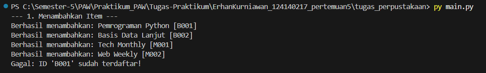
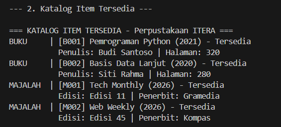
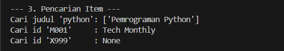
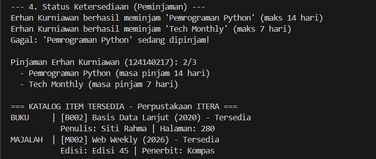
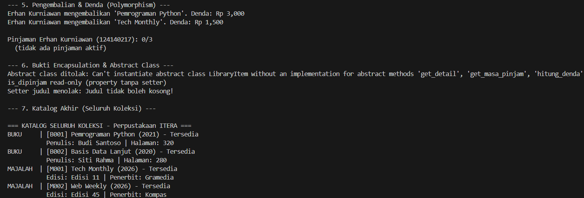

# Praktikum PAW Pertemuan 5 - Python OOP (Sistem Manajemen Perpustakaan)

**Program Studi Teknik Informatika - Institut Teknologi Sumatera**
**T.A. 2026/2027 Gasal**

## Identitas

- **Nama Lengkap:** Erhan Kurniawan
- **NIM:** 124140217
- **Kelas Praktikum:** RA
- **Pertemuan:** 05 - Python OOP

Repository ini berisi pengerjaan latihan hands-on (modul 1-6) dan Tugas **Sistem Manajemen Perpustakaan Sederhana** berbasis Python OOP untuk Pertemuan 5.

---

## Struktur Folder

```text
ErhanKurniawan_124140217_pertemuan5/
├── README.md
├── .gitignore                         # mengecualikan __pycache__/ dan venv/
├── latihan/
│   ├── 01_everything_is_object.py     # type(), id(), __class__ pada tipe bawaan
│   ├── 01_procedural_vs_oop.py        # perbandingan prosedural vs OOP
│   ├── 02_class_object.py             # class, atribut class/instance, dunder
│   ├── 03_inheritance.py              # inheritance, super(), overriding, MRO
│   ├── 04_encapsulation.py            # access modifier & property
│   ├── 05_polymorphism.py             # polymorphism, duck typing, operator overloading
│   └── 06_abstract_class.py           # abstract class & interface
└── tugas_perpustakaan/
    ├── library_item.py                # abstract class LibraryItem + Book + Magazine
    ├── member.py                      # class Member (anggota perpustakaan)
    ├── library.py                     # class Library (pengelola koleksi)
    └── main.py                        # skrip uji seluruh fungsionalitas
```

---

## Tugas - Sistem Manajemen Perpustakaan Sederhana

Lokasi: folder `tugas_perpustakaan/`.

### 1. Deskripsi Program

Program mensimulasikan perpustakaan yang menyimpan dua jenis item (**Buku** dan **Majalah**). Pengguna dapat menambahkan item, menampilkan katalog item yang tersedia, mencari item berdasarkan judul atau id, serta meminjam dan mengembalikan item (dengan perhitungan denda keterlambatan) melalui class `Member`.

**Alur program (`main.py`):**

1. Membuat objek `Library`, lalu menambahkan 2 buku dan 2 majalah (termasuk uji ID duplikat yang ditolak).
2. Menampilkan katalog item yang tersedia.
3. Mencari item berdasarkan judul (`cari_by_judul`) dan id (`cari_by_id`).
4. Meminjam item oleh `Member`, lalu memperlihatkan status ketersediaan berubah.
5. Mengembalikan item dan menghitung denda sesuai jenis item.
6. Membuktikan abstract class tidak bisa diinstansiasi serta encapsulation berjalan.
7. Menampilkan katalog seluruh koleksi.

**Penerapan 4 Pilar OOP:**

| Pilar         | Penerapan                                                                                                                                                                                                                                   |
| ------------- | ------------------------------------------------------------------------------------------------------------------------------------------------------------------------------------------------------------------------------------------- |
| Class/Object  | `LibraryItem`, `Book`, `Magazine`, `Member`, `Library` dibuat sebagai class; tiap buku/majalah/anggota adalah objek terpisah dengan state masing-masing.                                                                                    |
| Inheritance   | `Book` dan `Magazine` mewarisi `LibraryItem` dan memakai `super().__init__()` serta method konkret `pinjam()`, `kembalikan()`, `__str__()` dari parent.                                                                                     |
| Encapsulation | `__item_id` dan `__dipinjam` (private), `_judul` dan `_tahun_terbit` (protected), `__koleksi` di `Library`, `__daftar_pinjam` di `Member`. Akses lewat `@property` (`item_id`, `is_dipinjam` read-only; `judul` dengan setter tervalidasi). |
| Polymorphism  | `get_detail()`, `hitung_denda()`, dan `get_masa_pinjam()` dipanggil seragam pada tiap item, namun hasilnya berbeda (buku Rp 1.000/hari & 14 hari; majalah Rp 500/hari & 7 hari).                                                            |
| Abstraction   | `LibraryItem(ABC)` dengan 3 `@abstractmethod` sehingga tidak bisa diinstansiasi langsung dan subclass wajib mengimplementasikannya.                                                                                                         |

### 2. Pemenuhan Persyaratan Tugas

| No  | Persyaratan                                         | Implementasi                                              |
| --- | --------------------------------------------------- | --------------------------------------------------------- |
| 1   | Abstract class `LibraryItem`                        | `library_item.py` - `LibraryItem(ABC)`                    |
| 2   | Minimal 2 subclass yang mewarisi `LibraryItem`      | `Book` dan `Magazine`                                     |
| 3   | Subclass mengimplementasikan abstract method        | `get_detail`, `hitung_denda`, `get_masa_pinjam`           |
| 4   | Class `Library` untuk menyimpan & mengelola koleksi | `library.py` - koleksi private `__koleksi`                |
| 5   | Encapsulation (protected/private)                   | `__item_id`, `__dipinjam`, `_judul`, `__koleksi`, dll.    |
| 6   | Property decorator                                  | `item_id`, `judul` (getter + setter), `is_dipinjam`       |
| 7   | Menambahkan item                                    | `Library.tambah_item()`                                   |
| 8   | Menampilkan daftar item yang tersedia               | `Library.tampilkan_katalog()`                             |
| 9   | Mencari item berdasarkan judul atau id              | `Library.cari_by_judul()` dan `Library.cari_by_id()`      |
| 10  | Dokumentasi komentar                                | Docstring & komentar pada setiap class dan method penting |

### 3. Screenshot Output

> Catatan: File screenshot diletakkan di folder `docs/screenshots/pertemuan5/` (root repository).

| No  | Nama File          | Keterangan                                                     |
| --- | ------------------ | -------------------------------------------------------------- |
| 1   | `tambah_item.png`  | Penambahan item ke perpustakaan (termasuk ID duplikat ditolak) |
| 2   | `katalog.png`      | Katalog item yang tersedia                                     |
| 3   | `pencarian.png`    | Pencarian berdasarkan judul dan id                             |
| 4   | `peminjaman.png`   | Status ketersediaan setelah peminjaman                         |
| 5   | `pengembalian.png` | Pengembalian, denda polymorphic, dan bukti encapsulation       |

**Gambar 1 - Penambahan Item**



**Gambar 2 - Katalog Item Tersedia**



**Gambar 3 - Pencarian Item**



**Gambar 4 - Status Ketersediaan (Peminjaman)**



**Gambar 5 - Pengembalian, Denda, Encapsulation & Katalog Akhir**



### 4. Contoh Output

```text
--- 1. Menambahkan Item ---
Berhasil menambahkan: Pemrograman Python [B001]
Berhasil menambahkan: Basis Data Lanjut [B002]
Berhasil menambahkan: Tech Monthly [M001]
Berhasil menambahkan: Web Weekly [M002]
Gagal: ID 'B001' sudah terdaftar!

--- 3. Pencarian Item ---
Cari judul 'python': ['Pemrograman Python']
Cari id 'M001'     : Tech Monthly
Cari id 'X999'     : None

--- 5. Pengembalian & Denda (Polymorphism) ---
Erhan Kurniawan mengembalikan 'Pemrograman Python'. Denda: Rp 3,000
Erhan Kurniawan mengembalikan 'Tech Monthly'. Denda: Rp 1,500
```

---

## Latihan Modul (Hands-on 1-6)

Folder `latihan/` berisi kode hands-on dari modul: _everything is an object_, prosedural vs OOP, class & object, inheritance, encapsulation, polymorphism, dan abstract class. Jalankan masing-masing dengan `python latihan/<nama_file>.py`.

---

## Cara Menjalankan Program

### Prasyarat

- Python 3.10 atau lebih baru

### Langkah

```bash
cd ErhanKurniawan_124140217_pertemuan5/tugas_perpustakaan
python main.py
```

---

## Teknologi

- Python 3 (modul standar `abc`)
- Konsep OOP: Class, Inheritance, Encapsulation, Polymorphism, Abstract Class

---

<div align="center">

**© 2026 · Tugas 5 Praktikum Pengembangan Aplikasi Web · Teknik Informatika ITERA**

</div>
