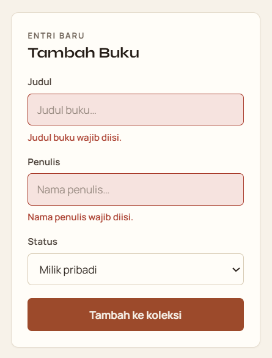
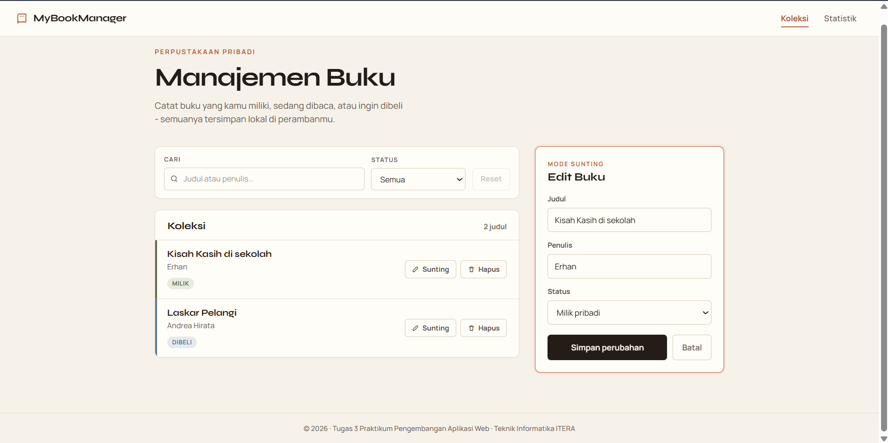
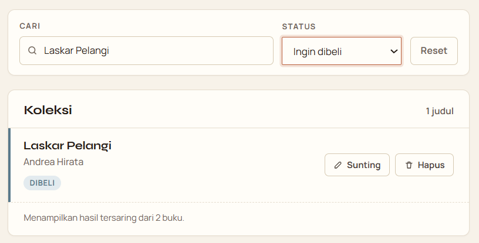
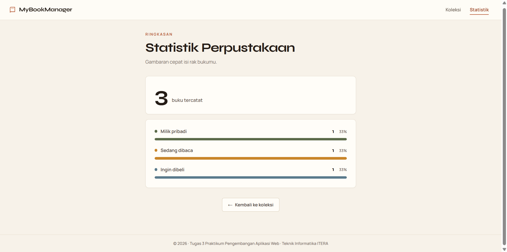
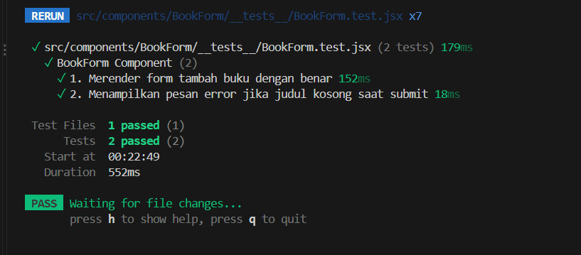
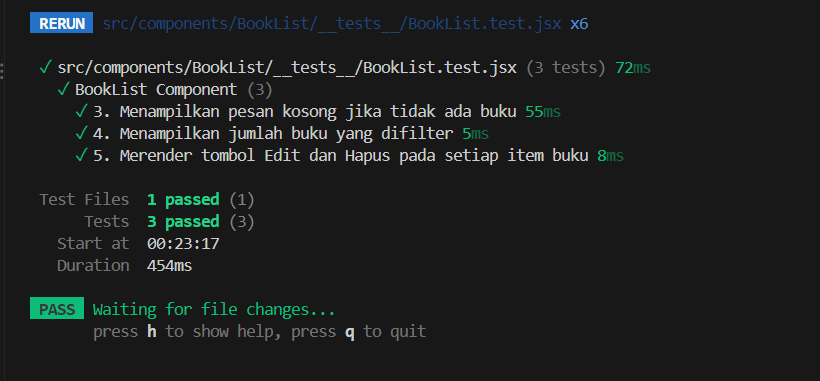

# Praktikum PAW Pertemuan 3 - React (Aplikasi Manajemen Buku Pribadi)

**Program Studi Teknik Informatika - Institut Teknologi Sumatera**
**T.A. 2026/2027 Gasal**

## Identitas

- **Nama Lengkap:** Erhan Kurniawan
- **NIM:** 124140217
- **Kelas Praktikum:** RA 
- **Pertemuan:** 03 - React 

Repository ini berisi pengerjaan Tugas **Aplikasi Manajemen Buku Pribadi** berbasis React untuk Pertemuan 3.

---

## Struktur Folder

```text
ErhanKurniawan_124140217_pertemuan3/
├── README.md
├── DESIGN.md                          # catatan design system & tipografi
├── PRODUCT.md                         # definisi produk & fitur aplikasi
├── package.json
├── vite.config.js                     # konfigurasi Vite + Vitest (jsdom, setupFiles)
├── index.html
├── public/
│   ├── favicon.svg
│   └── icons.svg
└── src/
    ├── main.jsx                       # entry point React
    ├── index.css                      # reset & tipografi global
    ├── App.jsx                        # root: BookProvider + React Router (/, /stats)
    ├── App.css                        # styling navbar & layout global
    ├── context/
    │   ├── BookContext.jsx            # Context API: useReducer + aksi CRUD
    │   └── bookStore.js               # logika/bantuan penyimpanan data buku
    ├── hooks/
    │   ├── useLocalStorage.js         # Custom Hook #1 (persistensi state)
    │   └── useBookStats.js            # Custom Hook #2 (statistik koleksi)
    ├── components/
    │   ├── BookForm/
    │   │   ├── BookForm.jsx           # form tambah/edit + validasi input
    │   │   ├── BookForm.css
    │   │   └── __tests__/
    │   │       └── BookForm.test.jsx  # unit test (2 skenario)
    │   ├── BookList/
    │   │   ├── BookList.jsx           # daftar buku + tombol edit/hapus
    │   │   ├── BookList.css
    │   │   └── __tests__/
    │   │       └── BookList.test.jsx  # unit test (3 skenario)
    │   ├── BookFilter/
    │   │   ├── BookFilter.jsx         # filter status & pencarian judul/penulis
    │   │   └── BookFilter.css
    │   └── Toast/
    │       ├── Toast.jsx              # notifikasi feedback aksi CRUD
    │       ├── Toast.css
    │       └── toastBus.js            # event bus untuk toast
    ├── pages/
    │   ├── Home/
    │   │   ├── Home.jsx               # halaman utama: Form + Filter + List
    │   │   └── Home.css
    │   └── Stats/
    │       ├── Stats.jsx              # halaman statistik (useBookStats)
    │       └── Stats.css
    └── test/
        └── setup.js                   # setup global RTL (@testing-library/jest-dom)
```

---

## Tugas - Aplikasi Manajemen Buku Pribadi

Lokasi: root folder ini (project React + Vite terpisah dari latihan modul).

### 1. Penjelasan Singkat Fungsi Aplikasi & Fitur-Fiturnya

Aplikasi **Manajemen Buku Pribadi** memungkinkan pengguna mencatat buku-buku yang dimiliki, sedang dibaca, atau ingin dibeli dalam satu koleksi digital. Data disimpan secara persisten di `localStorage` sehingga tidak hilang saat halaman di-refresh atau browser ditutup. Aplikasi terdiri dari dua halaman (multi-page via React Router): **Beranda** untuk pengelolaan koleksi (CRUD + filter + pencarian) dan **Statistik** untuk ringkasan koleksi.

**Daftar Fitur:**

| Fitur                      | Keterangan                                                                                  |
| -------------------------- | ------------------------------------------------------------------------------------------- |
| Tambah Buku Baru           | Form judul, penulis, dan status (milik / baca / beli) dengan validasi kolom wajib isi       |
| Edit & Hapus Buku          | Tombol aksi pada setiap item daftar; mode edit mengisi ulang form dengan data buku terpilih |
| Filter Berdasarkan Status  | Dropdown filter: Semua / Milik / Sedang Dibaca / Ingin Dibeli                               |
| Pencarian Judul / Penulis  | Input pencarian real-time, case-insensitive, mencocokkan judul maupun nama penulis          |
| Error Handling & Feedback  | Pesan error teks + border merah pada input kosong saat submit                               |
| Halaman Statistik          | Total buku serta jumlah per status, dihitung oleh custom hook `useBookStats`                |
| Persistensi `localStorage` | Koleksi buku tetap tersimpan meski browser ditutup (key `paw-books`)                        |
| Navigasi Multi-Halaman     | Rute `/` (Beranda) dan `/stats` (Statistik) menggunakan React Router tanpa reload browser   |
| Notifikasi Aksi (Toast)    | Feedback visual singkat saat buku berhasil ditambah / diedit / dihapus                      |
| Responsif                  | Layout menyesuaikan ukuran layar desktop, tablet, dan mobile                                |

---

### 2. Screenshot Antarmuka Aplikasi

> Catatan: File screenshot diletakkan di folder `docs/screenshots/pertemuan3/` (root repository).

| No  | Nama File         | Keterangan                                           |
| --- | ----------------- | ---------------------------------------------------- |
| 1   | `home.png`        | Halaman utama: form, filter & pencarian, daftar buku |
| 2   | `home-error.png`  | Feedback validasi form (input kosong saat submit)    |
| 3   | `home-edit.png`   | Mode edit (form terisi data buku yang dipilih)       |
| 4   | `home-filter.png` | Hasil filter status & pencarian judul/penulis        |
| 5   | `stats.png`       | Halaman statistik (`/stats`)                         |
| 6   | `unit-test.png`   | Hasil eksekusi unit test di terminal (5 passed)      |

**Gambar 1 - Halaman Utama (Beranda)**


**Gambar 2 - Error Handling Form (Input Kosong)**



**Gambar 3 - Mode Edit Buku**



**Gambar 4 - Filter Status & Pencarian**



**Gambar 5 - Halaman Statistik**



---

### 3. Daftar Fitur React yang Diimplementasikan beserta Lokasi Kode

> Catatan: Penunjuk merujuk pada file & bagian kode versi final di repository ini. Nomor baris dapat disesuaikan melalui line gutter VS Code bila diperlukan.

| No  | Fitur React / Persyaratan Modul | File & Bagian Kode                                                                              | Implementasi                                                                                      |
| --- | ------------------------------- | ----------------------------------------------------------------------------------------------- | ------------------------------------------------------------------------------------------------- |
| 1   | Functional Components & Hooks   | Seluruh file `.jsx`                                                                             | Tidak ada class component; memakai `useState`, `useEffect`, `useReducer`, `useMemo`, `useContext` |
| 2   | `useState`                      | `BookForm.jsx` (`formData`, `errors`); `Home.jsx` (`filterStatus`, `searchQuery`, `bookToEdit`) | Mengelola state lokal form, error, filter, pencarian, dan mode edit                               |
| 3   | `useEffect`                     | `BookForm.jsx` (sinkronisasi mode edit); `BookContext.jsx` (sinkronisasi localStorage)          | Efek samping terkontrol saat data/props berubah                                                   |
| 4   | Context API + `useReducer`      | `context/BookContext.jsx` (`BOOK_ACTIONS`, `bookReducer`, `BookProvider`, `useBooks`)           | State management global CRUD buku tanpa prop drilling                                             |
| 5   | Custom Hook #1                  | `hooks/useLocalStorage.js`                                                                      | State React tersinkron otomatis dengan `localStorage` (persisten)                                 |
| 6   | Custom Hook #2                  | `hooks/useBookStats.js` (+ `useMemo`)                                                           | Menghitung total buku & jumlah per status (milik / baca / beli)                                   |
| 7   | React Router (multi-halaman)    | `App.jsx` (`BrowserRouter`, `Routes`, `Route`, `Link`); `Stats.jsx`                             | Navigasi halaman `/` dan `/stats` ala Single Page Application                                     |
| 8   | PropTypes (type checking)       | `propTypes` pada `BookForm`, `BookList`, `BookFilter`, `BookProvider`                           | Validasi tipe props pada seluruh komponen                                                         |
| 9   | Komponen Reusable (>= 3)        | `components/BookForm`, `BookList`, `BookFilter`, `Toast`                                        | Komponen modular yang dapat dipakai ulang dengan props terpisah                                   |
| 10  | List & Conditional Rendering    | `BookList.jsx` (`map`, `filter`, empty state)                                                   | Render daftar buku hasil filter/pencarian + kondisi rak kosong                                    |
| 11  | Error Handling Form             | `BookForm.jsx` (`validateForm`, class `.input-error`, `.error-text`)                            | Validasi kolom wajib isi + feedback visual jika input kosong                                      |
| 12  | Komentar dalam kode             | Seluruh file logika penting                                                                     | Komentar penjelasan pada context, hooks, validasi, dan filtering                                  |

---

### 4. Pemenuhan Persyaratan Wajib Modul

| No  | Persyaratan Wajib Modul                                | Implementasi                                                    |
| --- | ------------------------------------------------------ | --------------------------------------------------------------- |
| 1   | Menambah buku (judul, penulis, status milik/baca/beli) | `BookForm.jsx` + aksi `addBook` di `BookContext.jsx`            |
| 2   | Mengedit dan menghapus buku                            | Tombol di `BookList.jsx` + aksi `updateBook` / `deleteBook`     |
| 3   | Filter buku berdasarkan status                         | `BookFilter.jsx` + logika filtering di `BookList.jsx`           |
| 4   | Pencarian berdasarkan judul atau nama penulis          | Input pencarian `BookFilter.jsx` + pencocokan di `BookList.jsx` |
| 5   | Gunakan `useState` dan `useEffect`                     | `BookForm.jsx`, `Home.jsx`, `BookContext.jsx`                   |
| 6   | Minimal 3 komponen reusable                            | `BookForm`, `BookList`, `BookFilter` (+ `Toast`)                |
| 7   | Context API untuk state management                     | `BookContext.jsx` (`BookProvider` membungkus seluruh aplikasi)  |
| 8   | React Router untuk navigasi multi-halaman              | `App.jsx` (rute `/` dan `/stats`)                               |
| 9   | `localStorage` untuk penyimpanan persisten             | `hooks/useLocalStorage.js`                                      |
| 10  | Minimal 2 custom hooks                                 | `useLocalStorage.js` dan `useBookStats.js`                      |
| 11  | PropTypes pada seluruh komponen                        | Blok `propTypes` di setiap komponen                             |
| 12  | Minimal 5 test unit (React Testing Library / Vitest)   | `BookForm.test.jsx` (2 test) + `BookList.test.jsx` (3 test)     |
| 13  | Error handling form (validasi + feedback visual)       | `validateForm` + pesan error teks & border merah                |

---

### 5. Unit Testing & Error Handling (Vitest + React Testing Library)

Pengujian dikonfigurasi melalui `vite.config.js` (`environment: 'jsdom'`, `globals: true`, `setupFiles: './src/test/setup.js'`). Total **5 test unit** tersebar di dua file test:

| No  | File Test           | Skenario Test                                                              | Hasil   |
| --- | ------------------- | -------------------------------------------------------------------------- | ------- |
| 1   | `BookForm.test.jsx` | Form merender label Judul, Penulis, Status, dan tombol submit dengan benar | ✅ Pass |
| 2   | `BookForm.test.jsx` | Submit input kosong memunculkan pesan "wajib diisi" + class `input-error`  | ✅ Pass |
| 3   | `BookList.test.jsx` | State kosong menampilkan pesan "Belum ada buku"                            | ✅ Pass |
| 4   | `BookList.test.jsx` | Penghitung koleksi menampilkan jumlah buku ("0 judul") dengan benar        | ✅ Pass |
| 5   | `BookList.test.jsx` | Tombol Edit & Hapus tidak dirender saat daftar buku kosong                 | ✅ Pass |

**Cara menjalankan test:**

```bash
npm run test        # mode watch (Vitest)
npx vitest run      # sekali jalan (untuk laporan/screenshot)
```

**Gambar 6 - Hasil Eksekusi Unit Test di Terminal (5 passed)**




---

## Cara Menjalankan Aplikasi

### Prasyarat

- Node.js (versi 18.x atau lebih baru disarankan)
- npm

### Langkah Instalasi & Menjalankan (Development)

```bash
cd ErhanKurniawan_124140217_pertemuan3
npm install
npm run dev
```

Buka `http://localhost:5173/` pada browser.

### Build Produksi (Opsional)

```bash
npm run build
npm run preview
```

### Alur Pengujian Fitur

1. **Tambah buku:** isi form lalu klik tombol submit; buku muncul di daftar beserta notifikasi toast.
2. **Validasi:** kosongkan judul/penulis lalu submit; pesan error dan border merah muncul.
3. **Edit:** klik tombol Edit pada item; form berubah ke mode edit; simpan perubahan.
4. **Hapus:** klik tombol Hapus; konfirmasi muncul; item hilang dari daftar.
5. **Filter & cari:** pilih status dan ketik judul/penulis; daftar menyesuaikan secara real-time.
6. **Persistensi:** refresh halaman (`F5`); koleksi buku tetap ada (tersimpan di `localStorage`).
7. **Routing:** klik menu Statistik di navbar; halaman `/stats` terbuka tanpa reload dan angkanya sesuai koleksi.

---

## Teknologi

- React 19 (Functional Components & Hooks) - Vite 8
- React Router DOM 7 - navigasi multi-halaman
- Context API + `useReducer` - state management global
- PropTypes - type checking props
- Vitest + React Testing Library + jsdom - unit testing
- CSS3 (Custom Properties, Grid, Flexbox) - styling
- Web Storage API (`localStorage`) - persistensi data
- Design system & tipografi terdokumentasi pada `DESIGN.md` dan `PRODUCT.md`

---

<div align="center">

**© 2026 · Tugas 3 Praktikum Pengembangan Aplikasi Web · Teknik Informatika ITERA**

</div>
