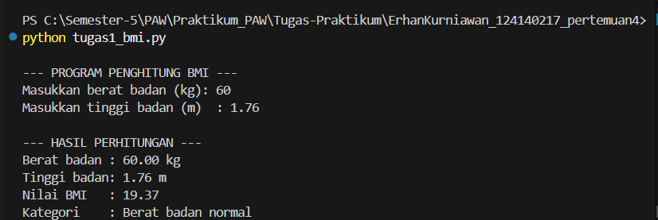
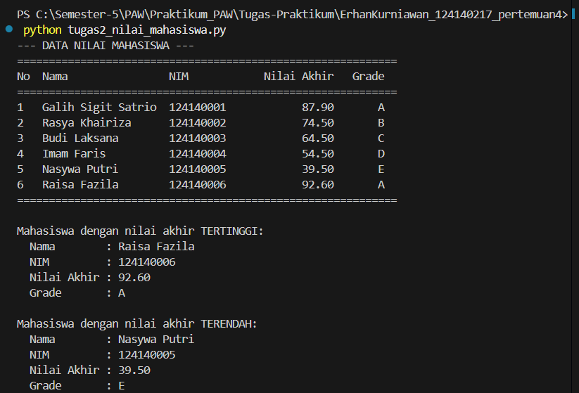
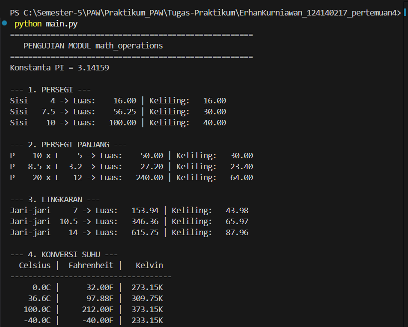

<div align="center">

# Tugas Praktikum Pengembangan Aplikasi Web (PAW)

**Program Studi Teknik Informatika · Institut Teknologi Sumatera**
Tahun Ajaran 2026/2027 Semester Gasal


</div>

---

## Daftar Isi

1. [Identitas](#1-identitas)
2. [Ringkasan Pertemuan](#2-ringkasan-pertemuan)
3. [Struktur Repository](#3-struktur-repository)
4. [Cara Menjalankan](#4-cara-menjalankan)
5. [Dokumentasi Tampilan](#5-dokumentasi-tampilan)
6. [Status Pengerjaan](#6-status-pengerjaan)

---

## 1. Identitas

| Keterangan         | Isi                                                                                             |
| :----------------- | :---------------------------------------------------------------------------------------------- |
| **Nama Lengkap**   | Erhan Kurniawan                                                                                 |
| **NIM**            | 124140217                                                                                       |
| **Kelas Praktikum**| RA                                                                                              |
| **Mata Kuliah**    | Pengembangan Aplikasi Web (PAW)                                                                 |
| **Repository**     | [pemrograman_web_itera_124140217](https://github.com/hanxx166/pemrograman_web_itera_124140217) |

Repository ini menghimpun seluruh tugas praktikum PAW. Setiap pertemuan ditempatkan pada
folder tersendiri yang dilengkapi README berisi penjelasan, cara menjalankan, dan
dokumentasi hasil.

---

## 2. Ringkasan Pertemuan

| Pertemuan | Topik                        | Hasil Pekerjaan                        | Teknologi                    | Dokumentasi                                                           |
| :-------: | :--------------------------- | :------------------------------------- | :--------------------------- | :-------------------------------------------------------------------- |
| 1         | HTML, CSS dan JavaScript Dasar | Mini POS: kasir dan keranjang belanja | Vanilla JS, localStorage     | [README](./ErhanKurniawan_124140217_pertemuan1/README.md)             |
| 2         | JavaScript Next Gen (ES6+)   | ITERA Student Hub: dashboard pribadi   | ES6 Modules, Fetch API       | [README](./ErhanKurniawan_124140217_pertemuan2/README.md)             |
| 3         | React                        | Aplikasi manajemen buku pribadi        | React 19, Vite, Vitest       | [README](./ErhanKurniawan_124140217_pertemuan3/README.md)             |
| 4         | Python Dasar                 | BMI, pengolahan nilai, modul matematika, latihan mandiri | Python 3.8+ (pustaka standar) | [README](./ErhanKurniawan_124140217_pertemuan4/README.md) |

### Pertemuan 4 (terbaru)

| Berkas                          | Deskripsi                                                              |
| :------------------------------ | :--------------------------------------------------------------------- |
| `tugas1_bmi.py`                 | Menghitung BMI dan menentukan kategori berat badan dengan `if-elif-else`. |
| `tugas2_nilai_mahasiswa.py`     | Mengolah data nilai 6 mahasiswa (list dan dictionary), menghitung nilai akhir dan grade, serta mencari nilai tertinggi dan terendah. |
| `math_operations.py`, `main.py` | Modul fungsi geometri dan konversi suhu beserta program utama yang mengimpornya dengan dua cara berbeda. |
| `latihan/`                      | Latihan mandiri Modul 1 sampai 6 (kartu identitas, konversi suhu, tebak angka, validasi password, katalog kontak, generator password). |

---

## 3. Struktur Repository

```text
.
├── README.md                              # Indeks seluruh pertemuan (berkas ini)
├── docs/
│   └── screenshots/                       # Dokumentasi tampilan per pertemuan
│       ├── pertemuan1/
│       ├── pertemuan2/
│       ├── pertemuan3/
│       └── pertemuan4/
├── ErhanKurniawan_124140217_pertemuan1/   # Mini POS (Vanilla JS)
│   ├── index.html
│   ├── style.css
│   ├── script.js
│   └── modul/
├── ErhanKurniawan_124140217_pertemuan2/   # Dashboard (ES6+)
│   ├── modul/latihan-js-next-gen/
│   └── dashboard-student/
├── ErhanKurniawan_124140217_pertemuan3/   # Manajemen buku (React + Vite)
│   ├── src/
│   │   ├── components/                    # BookForm, BookList, BookFilter, Toast
│   │   ├── context/                       # BookContext (Context API + useReducer)
│   │   ├── hooks/                         # useLocalStorage, useBookStats
│   │   └── pages/                         # Home, Stats (React Router)
│   └── public/
└── ErhanKurniawan_124140217_pertemuan4/   # Python dasar
    ├── tugas1_bmi.py
    ├── tugas2_nilai_mahasiswa.py
    ├── math_operations.py
    ├── main.py
    └── latihan/
```

---

## 4. Cara Menjalankan

Seluruh perintah dijalankan dari direktori utama repository.

<details>
<summary><b>Pertemuan 1</b> · Mini POS (Vanilla JS)</summary>

<br>

Tidak memerlukan server. Buka berkas berikut melalui Live Server (VS Code) atau langsung di browser:

```text
ErhanKurniawan_124140217_pertemuan1/index.html
```

</details>

<details>
<summary><b>Pertemuan 2</b> · Dashboard dan latihan modul (ES6+)</summary>

<br>

Memerlukan server lokal karena menggunakan ES Modules.

```bash
cd ErhanKurniawan_124140217_pertemuan2/dashboard-student
python -m http.server 8000
# buka http://localhost:8000
```

Latihan modul:

```bash
cd ErhanKurniawan_124140217_pertemuan2/modul/latihan-js-next-gen
python -m http.server 8000
```

</details>

<details>
<summary><b>Pertemuan 3</b> · Manajemen buku pribadi (React + Vite)</summary>

<br>

```bash
cd ErhanKurniawan_124140217_pertemuan3
npm install
npm run dev
# buka http://localhost:5173
```

Pengujian unit (5 test):

```bash
npx vitest run
```

</details>

<details open>
<summary><b>Pertemuan 4</b> · Python dasar</summary>

<br>

Prasyarat: Python 3.8 atau lebih baru. Tidak ada pustaka eksternal. Pengguna macOS atau Linux
dapat mengganti `python` dengan `python3`.

```bash
cd ErhanKurniawan_124140217_pertemuan4
python tugas1_bmi.py
python tugas2_nilai_mahasiswa.py
python main.py
```

Latihan mandiri:

```bash
cd ErhanKurniawan_124140217_pertemuan4/latihan
python latihan1.py
python latihan2_suhu.py
python latihan3_tebak.py
python latihan4_validasi.py
python latihan5_kontak.py
python main.py          # menguji modul password_gen (latihan 6)
```

</details>

---

## 5. Dokumentasi Tampilan

Tangkapan layar setiap pertemuan disimpan pada `docs/screenshots/pertemuan{N}/` dan
ditampilkan pada README masing-masing pertemuan. Berikut cuplikan pertemuan terbaru.

| Soal 1: BMI | Soal 2: Nilai Mahasiswa | Soal 3: Modul Matematika |
| :---------: | :---------------------: | :----------------------: |
|  |  |  |

---

## 6. Status Pengerjaan

| No | Topik                          | Status  |
| :-: | :----------------------------- | :-----: |
| 1  | HTML, CSS dan JavaScript Dasar | Selesai |
| 2  | JavaScript Next Gen (ES6+)     | Selesai |
| 3  | React                          | Selesai |
| 4  | Python Dasar                   | Selesai |
| 5  | -                              | Belum tersedia |

Tabel pada bagian 2 dan bagian ini diperbarui setiap kali pertemuan baru selesai dikerjakan.

---

<div align="center">

**© 2026 · Erhan Kurniawan (124140217) · Praktikum Pengembangan Aplikasi Web · Teknik Informatika ITERA**

</div>
